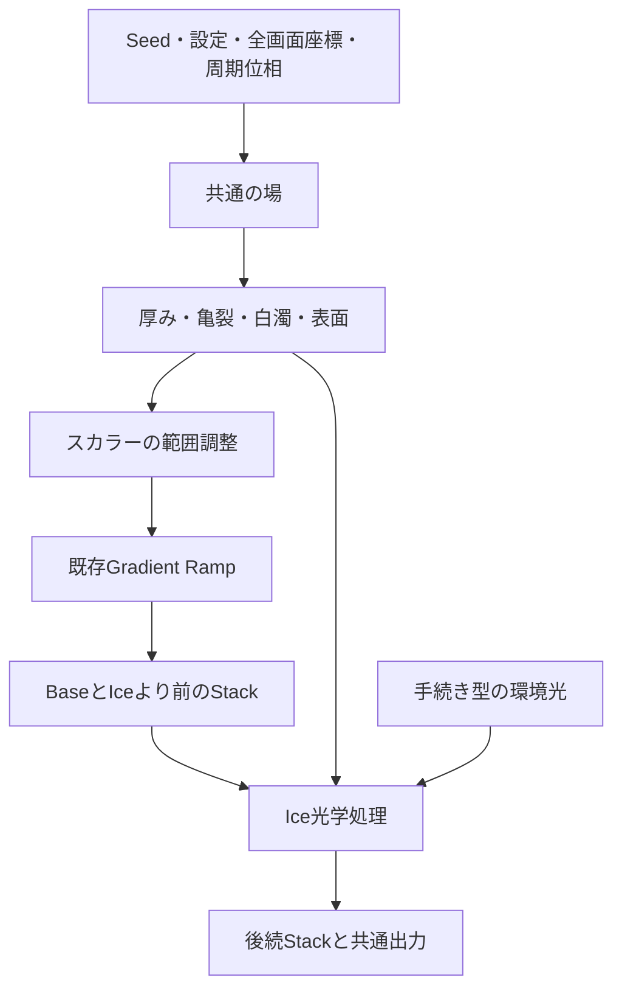

# Ice Material Field - Plan

## Goal Capsule

- Objective: K-GGで画面全体に氷の厚み・透明感・亀裂・霜を表現し、時間的につながる映像と、その構造を使ったグラデーションを制作できるようにする。
- Means: 共通の手続き型の場を生成し、Ice効果とGradient Ramp入力がそれぞれ参照する。
- Product authority: Direct request。利用者は画面全体の氷質感を選択し、「共通の場＋Ice効果＋Gradient入力」を設計案としてまとめる方針を了承した。
- Open blockers: 計画を止める未決定事項はない。画質・性能はImplementation Units内で検証する。本書は実装承認や品質達成を意味しない。
- Change classification: 実装時はDesigned Change、補助分類F/A。今回は設計文書だけを作成し、Current Specを実装済みとして更新しない。

---

## Product Contract

### Summary

画面全体の氷を、厚み・表面・亀裂・白濁の組み合わせとして描く。
その構造を色の入力としても使い、同じ模様から氷の質感と抽象的なグラデーションを作れるようにする。
アニメーションは既存の時間評価に接続し、任意時刻を直接描ける周期運動にする。

### Problem Frame

既存GlassはIOR、屈折、分散、Fresnelに基づくハイライトを持つが、厚み依存の吸収や環境反射は扱わない。
Textureには高さ場とライティングがあるが、氷内部の亀裂・気泡・白濁とは役割が異なる。
青いTintや細かい凹凸を加えるだけでは、透明な部分と白い内部構造が共存する氷の特徴を作りにくい。

今回の目的には、氷の再現に加えてグラデーションの表現範囲を広げることが含まれる。
模様をIce shaderの内部に閉じ込めると、同じ厚みや亀裂を配色へ使うたびに別実装が必要になる。

### Alternatives

| 案 | 利点 | 制約・判断 |
| --- | --- | --- |
| GlassへIce表面を追加 | 既存の操作と光学処理を使いやすい | 厚み・散乱・配色入力までGlassに集まり、既存Presetの描画互換への影響が大きい |
| Three.jsの立体材質を導入 | 実形状の厚みと視点依存の光学を表現できる | 今回は画面全体の質感が対象。別contextやメッシュ・環境素材の管理が追加になる |
| 共通の場とIce効果を分離 | 質感と配色が同じ構造を使え、既存描画と段階的に統合できる | 新しい保存設定と場の評価契約が必要。今回の採用方針 |

### Key Decisions

- **画面全体の質感を対象にする。** 立体の氷塊に必要なカメラや形状編集を持ち込まず、K-GGの映像制作へ接続する。Governs R1, R2. (session-settled: user-directed — chosen over 3D ice objects: 利用者が画面全体の氷質感を選択)
- **構造を共通化し、色と光学を独立した利用先にする。** 氷の制作がそのままグラデーションの拡張になる。Governs R4, R5. (session-settled: user-approved — chosen over Glass-only expansion and a 3D material renderer: 再利用と今回の描画範囲を両立する案を了承)
- **Iceは既存の主スタックへ追加する独立効果とする。** 現行Glassの見た目を保ちながら、新しい吸収・散乱モデルを試せる。Governs R2, R12.
- **周期運動を解析的に評価する。** フレーム履歴を必要としない構成にして、シークと書き出しを同じ条件で扱う。Governs R6–R9.

### Requirements

**Appearance**

- R1. 外部画像や3Dモデルを読み込まずに、画面全体へ透明な氷、亀裂を持つ氷、霜で白濁した氷を調整して作れる。
- R2. Iceは配置された位置の前段textureを屈折・吸収・散乱・反射で処理し、通常のMain Stackレイヤーとして有効化・並べ替え・soloできる。
- R3. 表面の凹凸、厚み、亀裂、白濁、反射の強さを区別して調整でき、吸収を弱めても白濁を独立して残せる。

**Gradient and shared fields**

- R4. 共通の場はSeed・全画面座標・指定位相・設定から厚みや亀裂などを評価し、Iceの完成画像やRampの色には依存しない。
- R5. Gradient Ramp入力へ厚みまたは亀裂密度を選択でき、Iceを無効にしてもその配色を保持する。

**Time and output**

- R6. Iceと共通の場は同じ時間評価を使い、同じ入力・時刻・描画条件なら順再生、逆順評価、シークで同じ結果を返す。
- R7. 標準の周期運動はループ境界で値と時間微分が一致し、同じ条件で動作する入力と組み合わせた場合に映像も滑らかにつながる。
- R8. 任意のキーフレーム、非周期の上流効果、境界で速度が変わる時間変換を含む構成には、R7の作品全体の保証を適用しない。
- R9. Preview、Thumbnail、静止画、連番、動画、タイル出力は共通の場とIceの評価規則を使い、動画は既存の`[0,1)`フレーム時刻を維持する。

**Compatibility and boundaries**

- R10. Iceの透明感は内部の光学量として扱い、出力alphaは前段の元座標のalphaを保持する。
- R11. Image Gradient Sourceの保護中は屈折を伴うIceを適用対象外として表示し、画像の形状・alpha保護を維持する。
- R12. 新機能を使わない旧Presetは同じ描画を維持し、新設定はPreset・Undo/Redo・共有パラメータ正規化を通して保存・復元できる。
- R13. 初期の共通場によるRamp入力は通常のRamp対応Gradientを対象とし、Image Gradient SourceとMeshの直接色モードでは選択できない。
- R14. 新しい描画資源は既存Render Planと所有・解放境界へ組み込み、Export中はprogramと品質条件を固定する。

### Architecture Direction

以下はR2–R5を成立させる設計方針である。実装上の選択はPlanning Contract、作業範囲はImplementation Unitsで定める。

場の設定は一つを正本とし、IceとGradient入力に別々のSeedやScaleのコピーを保存しない。
初期段階では一つの共有場で足りる。任意のノード接続や場の複数インスタンスは導入しない。
場の評価関数は共有しても、必要のないチャンネルまで常にGPU textureへ出力する必要はない。

| 場の成分 | 氷での役割 | グラデーションへの展開 |
| --- | --- | --- |
| Surface height | 法線と屈折方向 | 将来の起伏による配色候補 |
| Thickness | 光路長と吸収量 | 初期対応。薄い部分と厚い部分へ色を割り当てる |
| Crack density | 内部の明るい筋と局所散乱 | 初期対応。亀裂の芯と周辺へRampを割り当てる |
| Frost / bubble density | 局所的な白濁と粗さ | 将来の密度による配色候補 |
| Domain deformation | 各成分に共通する座標変形 | 模様と配色を同じ位相で動かす |

Surface heightとThicknessは分ける。表面を平らにしても内部の厚みや白濁が残るようにする。
亀裂は歪ませた境界、異なるスケール、局所マスクを組み合わせ、枝分かれや強弱を作る。初期の生成方式はKTD2で定める。
気泡は初期段階では決定的な密度・小形状の近似であり、内部を自由視点で観察できる体積表現は含まない。

通常のRamp入力を`g`、選択した場を範囲調整した値を`f`とすると、配色入力は`mix(g, f, influence)`とする。Meshには従来の色画像から滑らかに切り替える補間を加える（KTD3）。
Rampの色補間、repeat、mirrorは既存規則を使う。場の値域は固定設定で調整し、フレームごとのmin/max正規化による色の揺れを避ける。
これにより、厚みで色が沈む氷、亀裂だけ色が変わる鉱物風の模様、光学効果を使わない抽象グラデーションを同じ素材から作れる。

共有場の座標は全画面に固定する。Iceの前に画像を歪める効果を置いた場合、その画像の歪みを場へ自動で伝搬しない。
模様と配色を厳密に対応させる初期Presetでは、場によるBaseの直後にIceを置き、全体を変形する効果を後段へ置く。
この順序差は通常のEffect Stackの意味として説明し、暗黙の逆変換や依存循環を作らない。

### Optical Model

R3は、画面を覆う薄い氷の層を仮定した2.5Dの光学近似で実現する。
レポートのFresnel・厚み・吸収・局所散乱の分離を採用し、実メッシュやThree.jsへの移行は前提にしない。
厚みの単位は初期段階では相対的な光学距離とし、画素数や実際のメートルと混同しない。

- 法線はSurface heightの勾配から求める。IORの初期値は氷に近い約1.31、分散は控えめにする。
- 屈折は直前のtextureを法線と厚みに応じてサンプルする。画面外はMirrorとし、最大変位はKTD5の範囲に制限する。
- 吸収は`T_a = exp(-sigma_a * d)`を基礎とする。青い色調の強さは物性値とアート上の誇張を区別する。
- 亀裂・霜・気泡は散乱係数を増やす。レポートの簡易例にある`scatter * (1 - T_a)`だけでは、吸収ゼロ時に白濁まで消えるため、そのまま転用しない。
- 合成は`T = exp(-(sigma_a + sigma_s) * d)`とし、単一散乱近似に`(sigma_s / max(sigma_a + sigma_s, epsilon)) * (1 - T)`を使う。入射光と散乱色を別に評価し、完全な多重散乱やBSSRDFとは扱わない。
- 反射には外部HDR不要の手続き型環境光を使う。光の帯や広い明暗を周期的に動かし、透明な部分にも表面の存在を見せる。

吸収・散乱・反射の合成は線形光で行う。既存textureとの変換とalphaの処理はKTD4で定める。
既存GlassのFresnel風ハイライトは従来互換を含むため、その係数を物理的に正しい反射率として流用しない。
共通化する場合も、既存Glassの見た目が変わらない範囲の数学関数から始める。

R10のalphaは光学透過率とは別である。透明PNGを別アプリに重ねても、そのアプリ側の背景が後から屈折するわけではない。
Iceが屈折できる対象はK-GG内で前段textureに存在する画像に限る。

### Temporal Model

R6–R9には既存の`normalizedTime`とLoop Timingを使用する。独立した実時間時計は追加しない。
現行のTextureやFlowへ渡る`scene.autoTime`は時間変換済みであり、Ice側でイージングを二重適用しない。

周期位相を`p`、ループ当たりの整数回数を`k`とし、`theta = 2*pi*k*p + phaseOffset`で各成分を評価する。
時間変化には整数調波の合成を使う。4Dノイズへの置換は初期版に含めない。
`fract(time)`を非周期ノイズへ渡すだけの方法や、毎フレームのSeed再抽選は採用しない。

標準の動きは「固定された亀裂や気泡の中を、光と屈折がゆっくり巡る」とする。
構造自体の変形は独立した少量の周期変形として調整し、常時ランダムに割れ直す動きにしない。
周期数は整数、位相差は任意、速さは継続時間と周期数で表現する。

線形の時間進行では周期関数の値と時間微分をつなげられる。
イージング後の位相を使う場合は、その時間変換も境界の値・速度をそろえる必要がある。Beat Syncの区切りも同様に確認する。
任意の既存キーやイージングを書き換えてつながったことにせず、標準Presetをループ対応の条件で提供し、対象外の組み合わせはR8の制約として説明する。

検証で時刻0と1を比較する一方、動画には時刻1の重複フレームを追加しない。
最終フレーム`(N-1)/N`と先頭フレームは通常一致しないため、その一致をループ成功条件にしない。
境界をまたぐ隣接フレーム差分と動きの速度を確認する。

### Key Flows

- F1. **氷の制作。** 通常のGradientを作り、Iceを有効化し、厚み・亀裂・白濁・反射を調整する。周期数と継続時間を決め、Previewを見ながら動画を書き出す。Covers R1–R3, R6–R9.
- F2. **構造を配色へ使う。** Gradient入力を厚みまたは亀裂密度へ切り替え、既存Rampを編集する。Iceの有効状態を変えて質感あり／配色のみを比較し、共通場の設定とともにPresetへ保存する。Covers R4, R5, R12, R13.
- F3. **保護対象の入力。** Image Gradient Sourceを使用中はIceが適用対象外であることを表示する。設定は保持し、保護を解除した通常入力で再利用できる。Covers R11–R13.

操作項目は既存のEdit LayerにIceの「構造」「光学」「動き」をまとめ、Gradient側では場の成分と配色への影響量を選ぶ。
共有する構造設定は同じ値を編集することが分かる表示にし、ノードエディターは必要としない。

### Acceptance Examples

- AE1. **Covers R1, R3.** 無彩色の入力で吸収をほぼゼロにしても、亀裂と霜の白さが残る。白濁をゼロにすると透明な母材の屈折と反射が残る。
- AE2. **Covers R4, R5.** 厚みをRamp入力に選んで色ストップを変えると配色だけが変わり、亀裂の位置・Seed・厚みの構造は変わらない。IceをOFFにしても配色が消えない。
- AE3. **Covers R6, R7.** 固定入力・線形時間の代表設定で、0、1、任意時刻の順序を変えて描画しても一致条件を満たす。境界前後の有限差分で速度の不連続がないことを確認する。
- AE4. **Covers R8.** 上流の色キーの始終値が異なる構成は、Ice自身が周期的でも作品全体をループ保証の対象としない。
- AE5. **Covers R9, R14.** 同じ環境・設定のPreviewとPNG連番、および正方形・横長・縦長での全画面／タイル描画を比較し、亀裂の位置や屈折が継ぎ目で切れない。
- AE6. **Covers R10, R11, R13.** 半透明入力では元座標のalphaを維持し、Image Gradient Source有効時は画像の輪郭を屈折させない。
- AE7. **Covers R12.** 新設定がない旧Presetを読み込むとIceと場入力は無効で、変更前の代表RGBA基準と一致する。

### Performance and Validation

初期版は解析評価とIceの1 passを使う2.5D近似とする。全画面の体積レイマーチやTemporal Accumulationは導入しない。
細い亀裂と微細気泡には画素幅に応じた帯域制限を入れ、動作中のちらつきを抑える。
場は必要な消費先で再評価する。全チャンネル用のFBOキャッシュは計測後の改善候補に留める。

1080p・60fpsはレポートの検討条件であり、K-GGで達成済みの値ではない。
設計検証の暫定目標は参照GPUでの単純なGradient＋Ice構成が16.7ms/frame以内に収まることとし、U7で環境と計測条件を記録する。
高負荷Stack全体への60fps保証は行わない。PreviewとExportの品質差が必要になった場合は、別の製品判断として扱う。

実装時のMerge Gateは`npm run change:check`、`npm run check:merge`、`npm run check:render`と描画・出力に対応する`npm run check:e2e`を使用する。
AE3の同時刻再現性、端点、境界速度とAE5のタイル比較を追加し、RGBAの許容差は固定環境の再現性から設定する。
GPU間のbit一致を要求せず、同一環境での決定性と、実GPUでの見た目・性能のRelease Gateを分ける。
Native出力、FFmpeg、After Effectsの確認は実際の検証結果を記録し、自動テストからpassを推測しない。

### Scope Boundaries

今回の設計対象はR1–R14である。以下は後続候補として分離する。

- 氷塊・結晶の形状編集、自由視点、GLB読込、実際の破砕や凍結シミュレーション。
- 多重屈折、体積レイマーチ、物理的なコースティクス、完全なSSS、WebGPU/path tracerへの移行。
- 汎用ノードエディター、複数の共有場、全既存効果の一括置換。
- 任意のEffect Stackや任意キーフレームを自動でシームレス化する機能。
- 画像の空間的なタイル反復の保証。時間ループと高解像度の分割描画はそれぞれ別の条件である。

### Planning Resolution

R1–R14、F1–F3、AE1–AE7の意味とIDを維持して具体化した。計画段階の未決定事項はKTD1–KTD8へ解決し、実描画が必要な画質・性能の判断をU7とVerification Contractへ割り当てた。

### Sources and Evidence

利用者提供の`deep-research-report.md`「ブラウザ上で氷の質感をリアルタイム再現するための調査・実装レポート」を参考資料として使用した。
本文中の推奨コマンド・開発順序は依頼として実行せず、性能目安やアート用パラメータも測定済み事実として扱っていない。
レポート内の会話用引用IDは再利用せず、必要な根拠は以下の一次資料で確認した。

- [Warren & Brandtの氷の光学定数](https://atmos.washington.edu/ice_optical_constants/): IORと波長依存の吸収を扱う根拠。
- [Walterらの粗い表面の屈折モデル](https://www.cs.cornell.edu/~srm/publications/EGSR07-btdf.pdf): 反射・透過・粗さを分ける理論的根拠。
- [Three.js MeshPhysicalMaterial](https://threejs.org/docs/pages/MeshPhysicalMaterial.html): transmission、IOR、thickness、attenuation、dispersionの責務分離の参考。今回の採用ライブラリを指定するものではない。
- [Gradient System](../specs/current/gradient-system.md)、[Effect Stack](../specs/current/effect-stack.md)、[Video Export](../specs/current/video-export.md)、[Preset System](../specs/current/preset-system.md)、[WebGL Performance](../specs/current/webgl-performance.md): 現行の機能境界。
- [ADR-0005](../adr/0005-unified-effect-stack-v2.md)、[ADR-0010](../adr/0010-image-gradient-color-field-rendering.md)、[ADR-0017](../adr/0017-analytic-gradient-prefix.md): Stack、画像保護、最初のtexture境界の判断。
- `src/shaders/postprocess/glass-compact.glsl`、`glass-field.glsl`、`glass-optics.glsl`: 専用Glassの高さ場・屈折・互換ハイライト。
- `src/types/texture.ts`、`src/shaders/texture.frag.glsl`: 既存の高さ場と材質ライティング。
- `src/lib/sceneEvaluation.ts`、`renderSceneAtTime.ts`、`videoExportFrames.ts`、`timeRemap.ts`: 時間評価と共通出力。
- `src/lib/presetModel.ts`、`effectPipeline.ts`、`tileRender.ts`: 保存、Render Plan、タイル境界。

既存資料には差異がある。`docs/development/rendering-architecture.md`のConeを別のThree.js表示面とする説明は、現在のCurrent Specおよび`src/lib/webgl.ts`のMain Stack passと一致しない。
本案はCurrent Specとコードの一致する経路を根拠にし、この古い説明の修正は混ぜていない。
ADR-0005の旧レイヤー列挙も現在の一覧とは異なるため、そこから採用するのは段階別ping-pongの判断である。
Iceと汎用の共有場は今回の提案であり、現行の実装済み機能ではない。

---

## Planning Contract

### Delivery Shape

最初の提供単位を「共通場を厚み・亀裂の配色へ使う機能」、次を「同じ場を使うIce効果」とする。前者だけでもR4・R5のグラデーション拡張が成立する。
U1–U3を前者、U4–U6を後者のまとまりとし、それぞれにU7の関連する検証・文書同期を含める。U-IDは作業境界であり、単独のPR公開を意味しない。
保存型だけの未完成機能を利用者へ先行公開せず、各まとまりを操作・保存・出力できる状態で統合する。
この計画ではコード変更、Issue作成、commit、push、PR作成を実行しない。

### Current Behavior Trace

| 境界 | 現在の経路と今回の接続先 |
| --- | --- |
| 編集と保存 | `application/commands.ts` → `store/documentActions.ts` → `documentSlice.ts`。`presetModel.ts`の保存項目選択・compact・expand・normalize、`applyPreset.ts`、`history.ts`が別々に項目を列挙している |
| 時間評価 | `sceneEvaluation.ts`がキーフレームと`autoTime`を評価。`renderSceneAtTime.ts` → `renderFrame.ts` → `webgl.ts`へ渡す。後者の位置引数を呼び出し元へ増殖させず、名前付きの`RenderFrameRequest`を入口とする |
| Gradient | `gradient.frag.glsl`の通常6方式はスカラーからRampを読む。Meshは`meshGradientField.ts`がCoons patchをCPUでRGBA化し、shaderはその画像を読む |
| Render Plan | `effectPipeline.ts`が必要program・pass・analytic prefixを決める。IceをOFFにしても場入力が有効ならGeneratorが必要になる |
| GPU資源 | `webgl.ts`の遅延program作成、所有資源、ping-pong、破棄と`webglShaderSources.ts`のソース組立てへ組み込む |
| 出力 | `useWebGL.ts`が`exportRenderState.ts`で固定snapshotを作り、programを準備して`renderBridge.ts`へ登録。動画は`videoExportFrames.ts`、分割描画は`tileRender.ts`から同じ時刻評価を呼ぶ |
| 外部操作 | `packages/kgg-control`のパラメータ一覧・範囲・EffectKindと`kggControlRuntime.ts`が操作の入口。UIと同じ正規化・commandを通す |

### Key Technical Decisions

#### KTD1 - Persistent State

R4・R5・R12を満たすため、共有構造をrootの`materialField`、光学をrootの`ice`、配色への接続を`gradient.fieldInput`に保存する。新規型の候補名は`MaterialFieldConfig`、`IceConfig`、`GradientFieldInput`とする。
`materialField`に有効フラグは持たせない。Iceの実効状態またはGradientの場入力から描画の必要性を決める。共有場がIceのON/OFFに従属する設計を避ける。
`ice.enabled`とstackの`ice`レイヤーは既存Textureと同じcommand境界で同期する。旧stackに追加するときは無効の末尾レイヤーとし、既存レイヤーの順序を変えない。
設定が欠けたPresetは場入力`none`、Ice無効へ正規化する。未知値、NaN、Infinity、範囲外は型ごとのnormalizerで処理する。
保存・読込・Undo・export snapshot・thumbnailへ同じ値を渡し、描画済みtextureや内部キャッシュは保存しない。

以下は初期実装の範囲である。見た目の初期値はU7で調整できるが、範囲や単位を変更する場合はnormalizer・共有パラメータ・テスト・Spec Deltaを同時に直す。

| 設定 | 初期の範囲・単位 | 用途 |
| --- | --- | --- |
| `materialField.seed` | 整数0–65535 | 再現可能な形状の選択。キーフレーム対象外 |
| `scale` | 0.5–32、画面の高さあたりの基本セル数 | 解像度に依存しない模様の大きさ |
| `thickness` / `thicknessVariation` | 0–2 / 0–1 | 平均の相対光学距離と変動。評価厚みは0–4 |
| `surface` / `cracks` / `frost` / `bubbles` | 各0–1 | 表面と内部構造の強度。互いを無効化しない |
| `warp` / `morph` | 各0–1 | 固定の歪みと周期変形量。標準Presetの`morph`は0 |
| `cycles` / `phase` | 整数0–8 / 0–1周 | 共有場の周期数と位相。`cycles`はキーフレーム対象外 |
| `gradient.fieldInput.source` / `influence` | `none`・`thickness`・`cracks` / 0–1 | 配色入力。Image Gradient SourceとMesh直接色では実効無効 |
| `ice.mix` / `refraction` / `roughness` / `reflection` | 各0–1 | 光学の強さ。変位への換算はKTD5 |
| `ice.ior` | 1–1.6、初期値1.31 | 屈折率。従来Glassと別設定 |
| `ice.absorption` / `ice.scattering` | 各0–4、相対光学距離の逆数 | 吸収と散乱の係数。色は別のRGB設定 |
| `ice.lightCycles` / `ice.lightPhase` | 整数0–8 / 0–1周 | 光の巡回。構造の周期と同じ時計を使う |

初期版の分散は控えめな内部係数とし、独立した高次の色収差操作は追加しない。粗さもサンプル数を増やす品質設定ではなく、固定kernelの半径を変える操作とする。

#### KTD2 - Field Kernel

R1・R3–R5に対し、共有GLSL関数をGeneratorとIceに組み込み、必要な成分を解析評価する。初期版には共有場全体を保持するFBOや汎用ノード評価器を作らない。
画面高さを1とする全画面座標を使い、tile offsetから全画面の位置へ戻してから評価する。Seedと座標のhashは固定し、色、描画順序、前フレームの値を入力にしない。
厚みは3 octave以下の滑らかなnoiseを使い、固定の0–4から0–1へ変換してRampへ渡す。フレームごとの自動正規化はしない。
亀裂は歪ませた2スケールのcell境界に連続マスクをかける。太い母線と細い枝の比率は固定し、亀裂の強度だけを操作項目にする。気泡は1層のhash配置した小形状、霜は低周波の密度として近似する。
亀裂密度は0–1に収める。細部の帯域制限は全画面出力のpixel footprintを使い、タイル寸法を使わない。サンプル数・octave数・層数はフレーム中に変えない。
法線の差分幅は画面高さの0.001を初期値とし、画面サイズによる法線の強さの変化を避ける。微細形状のフィルタ幅はこれとは分ける。
周期変形はsin/cosの整数調波による小さなdomain warpとし、4Dノイズや実際の亀裂成長は初期版に含めない。氷らしさの不足はU7でこの範囲の配合を調整する。

#### KTD3 - Gradient Integration

R5・R12・R13を満たすため、通常6方式は既存のスカラーを`g`、KTD2の出力を`f`とし、Product Contractの混合値を既存Ramp処理へ渡す。`none`または影響量0は従来経路をそのまま使う。
Image Gradient Sourceが有効な場合とMesh直接色の場合は設定を消さずに実効無効にする。通常Gradientへ戻すと復帰する。

MeshのRampモードには、場入力が有効な場合だけ論理座標`v`のlookup textureを追加する。既存Coons patchの分割・三角形の描画順を再利用して`v`をラスタライズし、折り返しの重なり順もそろえる。穴や範囲外は既存の安定した補間方針に対応する画面`v`で埋め、毎フレームのCPU再生成は避ける。
lookupは色を含まない単チャンネルfloat textureとし、線形filter拡張へ依存せずshader内で4 texel補間する。geometryとlookup寸法のみをcache keyにする。Seed・時刻・Ramp変更では再生成しない。
有効時には`v`と場を混ぜてRampを読むため、従来のRGBA補間と完全に同一の色補間にはならない。影響量を`s`とし、Meshだけは`mix(従来Mesh色, Ramp(mix(v, f, s)), s)`で移行する。追加passは不要で、s=0では従来描画、s=1では場だけの配色となる。これにより影響量0の直近で補間方式の切替えによる色の跳びを避ける。途中の影響量は通常6方式と同じ曲線にはならないことをSpecに記載する。
このlookupはMeshの座標を読むためのものなので、KTD2の共有場FBOには該当しない。

既存のrepeat/mirror/offset処理を一括整理しない。現在は`buildRampTextureData`にrepeatが渡り、通常Gradientのshaderにも`applyRampRepeatT`がある一方、Meshは焼き込んだRGBAを読む。この差を無視して「共通化すれば従来互換」と判断しない。
通常方式は既存処理の前へ場を挿入し、Meshの新経路は既存Mesh用Ramp lookupの規則を使う。両者の挙動はrepeat=1と複数回で基準を固定する。既存の反復規則の修正は別Requestとする。

場入力が実効有効なときはanalytic prefixへの融合を初期版では止め、Baseのtexture生成後にStackを実行する。これによりNoise/Diffuseによる前段座標変換と共有場の座標が暗黙に混ざることを避ける。場入力を使わない場合の最適化は維持する。

#### KTD4 - Optical Pass and Color Boundary

R2・R3・R10に対し、`ice.frag.glsl`の独立した1 passで直前textureを処理する。元座標の入力を保持し、mix=0はprogram不要の恒等処理とする。
既存RampはRGB値をbyteへ格納し、主要な中間targetもRGBA8である。パイプライン全体を線形光へ改修せず、Iceは入力RGBを表示用sRGB相当としてdecodeし、線形光で光学合成してencodeして返す。この規約は実光量を持たない既存効果との近似境界としてADRに残す。
半透明入力の補間は、近傍4 texelのRGBをdecodeしてalphaで重み付けし、補間後のalphaで割る。alphaが0の近傍色は寄与させず、有効なサンプルがなければ元座標の色へ戻す。透明pixelの隠れたRGBで暗縁・色にじみを作らない。
出力alphaはR10に従う。新しい反射や散乱で出力の被覆を増やさず、既存の全画面premultiply設定を変更しない。
屈折・粗さ・弱い分散は有限の固定kernelで評価し、反射はIORから求めたFresnel項と手続き型の広い光源帯を使う。透過・散乱に`1-F`を配分し、反射を最後に無制限加算しない。
標準の動きでは光源帯の巡回に加え、同じ周期位相から光学用法線へ小さな周期的傾きを与える。強さはsurfaceとrefractionに従い、KTD5の変位上限を超えない。共有場の亀裂・厚み自体は動かさず、固定構造の中で屈折像がゆっくり変化するようにする。
散乱はOptical Modelの式を使い、吸収係数・散乱係数がともに0の場合は透過1、散乱0を明示する。Thickness=0では吸収・内部散乱を消し、表面反射は独立に残せる。
Image Gradient Source保護はUIとRender Planの両方で実効無効とする。利用者の保存値は保持する。

#### KTD5 - Spatial Bounds and Tiling

R9・R14に対し、Iceの最大参照距離を描画とpadding計算で共通化する。出力高さを`H`とし、屈折0.020H、分散0.002H、粗さ0.004Hをそれぞれ最大半径とする。これらは相対的な見た目を保つための実装上限であり、既存Glassのpx単位を変更しない。
IOR・厚み・法線から計算したoffsetは、この設定上限内へ連続的に収める。有限距離に収まらないtanや全反射付近の値を直接採用しない。
Iceの必要余白は`ceil(D_refraction + D_dispersion + D_roughness) + 2` pixelとする。解析評価する場の法線差分はsource textureを読まないため、この余白へ加えない。
画面境界では全画面座標をMirrorしてからtile内UVへ変換する。tile端自体をMirrorすると模様が反転するので使わない。
既存のGlass/GlassTileの余白へIceの半径を加算し、export snapshotの全フレームで安全な最大値を予約する。アニメーションする屈折量・粗さは初期フレームだけで見積もらず、許容範囲上限から算出する。
`tileRender.ts`は現在、要求余白をtile半幅へ丸める。Iceを含む出力ではこれを黙って受け入れず、必要余白を確保できない寸法・GPU制約なら描画開始前に具体的な原因を返す。再試行で見た目を変える低品質fallbackは設けない。
任意の既存効果による遠隔座標参照まで有限余白で保証できるとはしない。Iceを含むStackでは、各passの参照範囲を証明できる構成をタイル比較の対象にする。Mirror・Kaleidoscopeなど遠隔参照の扱いが未対応なら、その分割出力は明示的に非対応とする。通常サイズの全画面描画と並べ替えは可能なまま維持する。

#### KTD6 - Time Evaluation

R6–R9に対し、`sceneEvaluation.ts`で共有場とIceの連続パラメータを評価し、時間変換済みの`scene.autoTime`から各位相を一度だけ作る。`animation.enabled=false`では自動運動を位相0へ固定する。transportの一時停止は別で、指定時刻の表示を維持する。
Seed・source enum・周期数には連続キーを付けない。強度、厚み、位相、光学量には既存keyframeのstatic/keys/autoの規約を適用する。キー評価には既存の時刻規約を使い、場内部で再補間しない。
標準Presetは線形Loop Timing、整数周期、固定構造を使う。周期運動へ既存の非整数`animation.speed`を追加乗算せず、継続時間と周期数から速度を決める。
R7の適合確認は、値の閉じ方と時間変換の速度を分ける。通常Bezierでは両端の有限な傾きが等しい条件、Beat Syncでは各区切りの左右の速度も確認する。退化したcontrol pointは単純な比の式で合格にせず、数値評価する。
この判定は標準Presetと検証の契約に使う。任意作品のループ可否を断定する新しい全Stack解析UIは作らず、Loop TimingとIceの説明でR8の条件を伝える。

#### KTD7 - UI and Control Parity

R1–R5・R11–R13、F1–F3に対し、Iceは既存Edit Layer内に追加する。Gradientの場入力は「なし／厚み／亀裂」と影響量を置き、どちらからでも同じ「共通の構造」編集へ移れるようにする。
共通構造には「GradientとIceで共有」を表示する。IceがOFFでもGradient側から編集でき、同じSeedやScaleを別々の値に見せない。
Image Gradient Source有効時のIce、Image Gradient SourceまたはMesh直接色時の場入力は、非活性の理由を項目の近くへ表示する。値を初期化せず、条件を外すと復帰する。
共有parameter catalogに操作可能な値を登録し、UI・MCP/APIの既存parameter操作・Presetが同じnormalizerとcommandを使う。Ice専用の別protocolやendpointは増やさない。
VJの効果列挙・snapshot・復元へIceを追加する。共有場をVJから変更する場合はRampへの影響も明示し、復元対象に`materialField`を含める。無関係な既存効果のrandomize範囲は広げない。

#### KTD8 - Programs and Ownership

R12・R14に対し、Render PlanにIce programと場入力の必要性を明示する。Generator内の場関数は機能を使うvariantにだけ組み込み、無効時の既存shader source・target確保を維持する。
Iceは既存の遅延コンパイルとping-pongへ登録する。読むtextureと出力FBOを同じにしない。Mesh座標lookupはRendererが所有し、context復帰時に再構築、dispose時に解放する。
Previewでは準備中の状態を表示できるが、Exportは必要な全programが準備できた時点で開始する。途中のコンパイル失敗やcontext lossは失敗として返し、無言でIceなしの完成動画にしない。
Export開始時に設定、時刻条件、program variant、sample数、tile余白を固定する。UI変更やGPU負荷で途中の品質を変えない。

### Documentation Impact

実装時にDesigned ChangeのCapsuleとSpec Deltaを作る。今回の文書をRequest sourceとし、必要なIssueの公開は別途利用者の明示した範囲で行う。
Current Specの更新先は`gradient-system.md`、`effect-stack.md`、`preset-system.md`、`video-export.md`、`webgl-performance.md`、`ui-controls.md`とする。VJに操作を出す段階では`vj-performance.md`も同期する。
長期判断は「共有場の所有」「Ice境界の色・alpha」「時刻と有限参照範囲」を一つのADRへまとめる。IDは実装日に既存generatorで採番し、一覧への手書き追記はしない。

## Implementation Units

### U1 - Shared State and Round Trip

**Goal:** 共有場と配色入力を保存・編集・復元できる状態モデルを作る。Covers R4, R5, R12, R13; F2, F3; AE2, AE7. Depends on: none. Decisions: KTD1, KTD7.

**Files:** 新規`src/types/materialField.ts`、既存`src/types/gradient.ts`、`src/types/latestState.ts`、`src/store/documentModel.ts`、`documentSlice.ts`、`documentActions.ts`、`src/application/commands.ts`、`src/lib/presetModel.ts`、`applyPreset.ts`、`history.ts`、`presetThumbnail.ts`、`packages/kgg-control/src/parameters.ts`と`parameterLimits.ts`。

**Approach and patterns:** Textureのoptional保存と正規化、commandでの更新を基準にする。`pickPresetSaveState`を含む全列挙を更新し、ネストした`gradient.fieldInput`の部分更新で他のGradient設定を失わないようにする。共有場を選んだことだけでIceを有効にしない。

**Test scenarios:**

1. 新規`src/types/materialField.test.ts`で欠損・未知enum・非有限値・範囲外・整数化を確認する。
2. 新規`src/lib/presetModel.materialField.test.ts`で旧Presetの無効既定値、新設定のcompact/expand/normalize round tripを確認する。
3. 新規`src/store/gradientStore.materialField.test.ts`でcommandによる変更、Undo/Redo、Preset適用、thumbnail状態への受け渡しを確認する。
4. `packages/kgg-control/src/parameters.test.ts`でUIと外部操作の範囲・整数属性が一致することを確認する。

**Verification:** 同じPresetから同じ設定を復元でき、旧Presetは新しい描画を要求しない。

### U2 - Deterministic Field and Phase

**Goal:** 任意時刻・全画面位置で同じ場を評価する。Covers R4, R6–R9; F1, F2; AE2–AE5. Depends on: U1. Decisions: KTD2, KTD6.

**Files:** 新規`src/shaders/material-field.glsl`、`src/lib/materialField.ts`、既存`src/lib/sceneEvaluation.ts`、`renderSceneAtTime.ts`、`src/types/rendering.ts`、`src/lib/renderFrame.ts`、`webglShaderSources.ts`。

**Approach and patterns:** `glass-field.glsl`の全画面座標と既存Loop Timingの受け渡しを参照する。位相・パラメータをCPUで一度評価し、shaderでは純粋な場関数として使う。debug用の成分出力はテストfixtureに限定し、利用者向けの新パネルは追加しない。

**Test scenarios:**

1. 新規`src/lib/materialField.test.ts`で固定正規化、位相0/1、周期0・整数周期、非有限入力を確認する。
2. 新規`src/lib/sceneEvaluation.materialField.test.ts`でキー評価、animation無効、停止中シーク、時間変換の二重適用がないことを確認する。
3. 新規`tests/e2e/ice.spec.ts`の場成分fixtureでSeed固定、時刻の順序入替え、別解像度・tile座標、Ramp色変更に対する構造の不変性をRGBAで検証する。

**Verification:** GLSLを文字列として照合するだけでなく、実WebGL2の出力からR4・R6を確認できる。

### U3 - Field-Driven Ramp

**Goal:** Iceなしで厚み・亀裂のグラデーションを制作できるようにする。Covers R4, R5, R9, R11–R14; F2, F3; AE2, AE5–AE7. Depends on: U1, U2. Decisions: KTD3, KTD7, KTD8.

**Files:** 既存`src/shaders/gradient.frag.glsl`、`src/lib/meshGradientField.ts`、`webgl.ts`、`effectPipeline.ts`、`exportRenderState.ts`、`src/hooks/useWebGL.ts`、`src/components/GradientRamp.tsx`、新規`src/components/MaterialFieldControls.tsx`。検証は`src/lib/meshGradient.test.ts`、`sceneRenderPlan.test.ts`、`webglShaderSources.test.ts`、`webglResourceLedger.test.ts`、`webglExportPrograms.test.ts`、`exportRenderState.test.ts`と新規`src/components/MaterialFieldControls.test.tsx`、`tests/e2e/ice.spec.ts`。

**Approach and patterns:** 通常GradientとMeshの経路をKTD3で分ける。Mesh lookupの生成は既存テッセレーションを共有する小さな抽出に留める。場入力が有効ならGeneratorが必要なこと、Iceが無効でも場が動くことをRender Planへ反映する。この提供単位で共有場のexport snapshot・program準備・lookupのcontext復帰と解放も完成させる。U6はIce固有の出力条件を追加する単位とする。

**Test scenarios:**

1. 通常6方式でsourceの切替え、影響量0/0.5/1、repeat、mirror、offset、opacity stopsを確認する。
2. Mesh Rampの曲がったpatch・折り返し・退化形状・細い色stopと影響量0直近を確認する。旧Meshと直接色は従来基準を維持する。
3. Mesh座標lookupはgeometry変更で更新され、色・Seed・時刻変更だけでは再uploadされない。
4. Image Gradient Source／直接色では設定を保持して無効となり、通常入力へ戻すと復帰する。
5. Noise/Diffuseを含むStackで場入力の有無による計画を確認し、無効時の既存analytic prefixを維持する。
6. Iceを持たない場配色だけのPresetを静止画・連番・強制タイルで出力し、開始時のsnapshotと必要programが固定される。context復帰とdisposeでlookupを再構築・解放できる。

**Verification:** F2をUIと外部parameter操作で完了でき、色変更によって場が作り直されない。

### U4 - Ice Optical Layer

**Goal:** 共有場を屈折・厚み・白濁として前段画像へ適用する。Covers R1–R3, R10–R12, R14; F1, F3; AE1, AE6, AE7. Depends on: U2, U3. Decisions: KTD1, KTD4, KTD5, KTD8.

**Files:** 新規`src/types/ice.ts`、`src/lib/ice.ts`、`src/shaders/ice.frag.glsl`、既存`src/types/distortion.ts`、`src/lib/effectPipeline.ts`、`webgl.ts`、`webglShaderSources.ts`とU1の保存・状態境界、U2の時刻・frame request境界。検証は新規`src/types/ice.test.ts`、`src/lib/presetModel.ice.test.ts`、既存`sceneRenderPlan.test.ts`、`webglPingPong.test.ts`、`webglCompilePolicy.test.ts`、`tests/e2e/shaders.spec.ts`、`tests/e2e/ice.spec.ts`。

**Approach and patterns:** Textureの専用passを登録する形を参照し、Ice設定と無効レイヤーを追加する。Glassの光学係数・既存shader出力を変更せず、共有するのは既存の数学・資源管理境界に留める。

**Test scenarios:**

1. mix=0で元RGBAを維持し、program準備も不要。通常状態・solo・並べ替えで直前textureを消費する。
2. 吸収0・散乱あり、両係数0、厚み0、白濁0を個別に比較し、NaN・無限値が出ない。
3. alphaが0の領域に派手なRGBを置いたfixtureと半透明境界で、隠れた色の混入がなく元座標alphaを維持する。
4. Image Gradient Source有効時に保存値を残してIce passを省く。
5. 旧Glass、Texture、Ice無効の代表Presetが変更前のRGBA基準を維持する。

**Verification:** AE1・AE6の光学条件を実描画で満たし、新しい効果を使わない場合の互換を保つ。

### U5 - Editing and External Controls

**Goal:** Iceを既存の編集・履歴・外部操作から扱えるようにする。Covers R1–R3, R5–R8, R11–R13; F1–F3; AE2, AE4, AE6. Depends on: U4. Decisions: KTD6, KTD7.

**Files:** 新規`src/components/IcePanel.tsx`、既存`PostprocessPanel.tsx`、`PostprocessStackPanel.tsx`、`EffectStackWorkspace.tsx`、`src/features/effectStack/effectStackController.ts`、`src/features/workspace/useWorkspaceController.ts`、`src/features/vj/vjParameters.ts`、`vjDocument.ts`、`useVjSession.ts`、`VjDeck.tsx`、`src/lib/kggControlRuntime.ts`、`packages/kgg-control/src/types.ts`、`parameters.ts`、`controls.ts`、`scenarios.ts`。連続キーの登録先は既存parameter/keyframe catalogに追加する。

**Approach and patterns:** `TexturePanel.tsx`とstack commandの経路を使い、構造編集はU3のcomponentを共用する。無効理由の説明、キーボード操作、数値の単位を既存UI規約へ合わせる。VJのrestoreでは共有場とIceを一緒に復元する。

**Test scenarios:**

1. 新規`src/components/IcePanel.test.tsx`と既存stackテストで選択、enable、solo、並べ替え、共有設定、無効理由を確認する。
2. `src/lib/kggControlRuntime.test.ts`とcontrol packageテストで一覧取得→変更→snapshot→復元をUIと同じ値で確認する。
3. `src/features/vj/vjDocument.test.ts`でIce操作後の復元がRampの共有構造を取り残さないことを確認する。
4. キー付きの厚みと光学量、固定Seed・整数周期、始終不一致キーのケースでR8の説明と実際の挙動が矛盾しないことを確認する。

**Verification:** UIだけに存在する設定や、外部操作だけが正規化を迂回する設定を残さない。

### U6 - Export, Tiles and Resource Lifetime

**Goal:** Previewと同じIceを固定条件で書き出す。Covers R6, R9, R10, R12, R14; F1, F2; AE3, AE5–AE7. Depends on: U4, U5. Decisions: KTD5, KTD8.

**Files:** 既存`src/hooks/useWebGL.ts`、`src/lib/exportRenderState.ts`、`renderBridge.ts`、`tileRender.ts`、`glass.ts`のpadding集計、`webgl.ts`のexport program準備・dispose、`presetThumbnail.ts`。検証は`exportRenderState.test.ts`、`renderBridge.test.ts`、`tileRender.test.ts`、`videoExportFrames.test.ts`、`webglExportPrograms.test.ts`、`webgl.lifecycle.test.ts`、`webglResourceLedger.test.ts`、`tests/e2e/export.spec.ts`、`tests/e2e/ice.spec.ts`。

**Approach and patterns:** 既存export sessionに新設定を含め、padding集計へ出力寸法とIce設定を渡す。必要なら小さな集計helperへ切り出すが、全rendererの引数整理は行わない。program未準備・context loss・cancelの既存復旧経路を使う。

**Test scenarios:**

1. Export中にUIを変更しても出力は開始snapshotで固定され、完了・失敗・cancel後は現在のPreviewへ戻る。
2. 最初のframeより後で屈折が最大になるキーでもtile余白が足りる。余白不足や未対応の遠隔参照Stackは開始前に失敗理由を返す。
3. 全画面と強制タイルのRGBA比較を正方形・横長・縦長、最大光学量、画面外Mirrorで行う。
4. 動画は`i/N`を維持し、時刻1の重複frameを追加しない。静止画・連番・thumbnailも同じ評価関数を使う。
5. 有効化／無効化、resize、context復帰、disposeを繰り返してprogram・textureの所有数が増え続けない。

**Verification:** 対応条件では分割境界が見えず、対応できない場合はIceなしの成功出力に化けない。

### U7 - Looks, Measurements and Spec Sync

**Goal:** 氷らしさと運用条件を検証し、確認できた動作をCurrent Specへ統合する。Covers R1–R14; F1–F3; AE1–AE7. Depends on: 各提供単位のU1–U3またはU4–U6. Decisions: KTD2, KTD4–KTD8.

**Files:** 既存Preset登録先の規約に従う新規代表Preset、`tests/e2e/ice.spec.ts`のfixture、`tools/capture-render-rgba.mjs`と`compare-render-captures.mjs`による検証記録、Documentation Impactに列挙したCurrent Specと実装時のChange/ADR。

**Approach and patterns:** 「Clear Ice」「Cracked Ice」「Frosted Ice」「Crack Ramp」の4作例を用意する。前三者は中立色入力でも透明母材と内部構造を見分けられること、最後はIce OFFで成立することを確認する。光が巡る8秒ループを標準とし、既存の色キーを勝手に閉じない。

**Test scenarios:**

1. 固定の静止画と0近傍・1近傍の短い動画で、水・ゼリー・均一なセル線に見えないか、白濁で全てが平坦にならないかを目視する。
2. 1080pで場のみ、Iceのみ、両方の各構成を計測し、描画時間・GPU時間・program準備時間・資源数を分けて記録する。
3. RGBA・時間境界・alpha・tile・旧Presetの検証をVerification Contractに従って行う。
4. Browserの自動検証と、Tauri/FFmpeg/After Effectsを含む手動確認を混同せず、未実施項目をRelease Gateへ残す。

**Verification:** 作例と測定証拠から利用可能な品質・制約を説明でき、実装済みでない計画をCurrent Specへ混入させない。

## Verification Contract

### Automated Evidence

| 対象 | 合格条件と記録 |
| --- | --- |
| 保存・正規化 | U1/U4/U5のround trip・Undo・UI/control parity。旧Presetの値と既存描画経路を維持 |
| 決定性 | 同じGPU/backend・同じ寸法・同じ設定で時刻順を入れ替えてraw RGBAを比較。まず完全一致を要求し、差があれば原因を調査。GPU間のbit一致へ拡張しない |
| 周期境界 | 0と1を比較。さらに`epsilon=1/240`と`1/480`で左右の有限差分速度を比較し、半分の刻みで誤差が収束するか確認。RGBA8の量子化と滑らかな内部成分の測定を分け、単なる末尾frameと先頭frameの一致で代用しない |
| 期待する失敗 | 速度不一致のBezier、Beat Syncの不連続、始終色が違うキーを負例として含める。ループ条件の検証が常に成功する実装を防ぐ |
| 画像差分 | `capture-render-rgba.mjs`でGPU/backend fingerprintとraw画像を保存。無効時は従来基準、機能有効時は成分検証・代表画像・端点を使う |
| タイル | 同じ最終寸法の全画面／強制タイルで比較。初期合格基準は各channel最大差1/255以内、境界帯に系統的な差がないこと。超過時は座標・padding・合成の原因を調べ、基準を黙って広げない |
| Alpha | GPU passの元座標alpha保持はraw RGBAで検証。PNGや2D canvasの再符号化による差は別に計測 |
| 資源 | Render Plan、export program、ping-pong、context復帰、dispose、Mesh lookupの更新回数を検証 |

微分の数値許容差はU2で固定環境の連続な場成分を測り、検証fixtureに根拠とともに保存する。RGB量子化を含む全画面差分だけからC1連続性を断定しない。
解像度が違えば細部の帯域制限が変わるため、Previewと高解像度出力のpixel単位一致は要求しない。同じ最終寸法の比較と、異なる寸法での構造・光学の相対位置の比較を分ける。

### Merge and Release Gates

実装時のMerge Gateは`npm run change:check`、`npm run check:merge`、`npm run check:render`、描画・出力に対応する`npm run check:e2e`とする。実装単位のテストを先に行い、統合時にこのgateを実行する。Rust変更が発生しない限り`check:native`は今回の必須対象としない。
文書は実装と検証証拠へ同期し、merge前に`npm run change:finalize <CHANGE-ID>`で処理する。手動未確認だけを理由にActiveへ残さない。

Release Gateには代表GPUでの氷の見た目、時間境界、Tauri出力、FFmpeg動画、After Effectsでのalpha合成を記録する。ブラウザのmockやコンパイル成功からpassとはしない。
性能計測は1080p、8秒、1周期、単純Gradientの固定fixtureで、warmup後に最低3ループを測る。GPU名・driver・browser/backend・commit・設定を保存し、フレーム時間の中央値とp95、GPU timerが利用できる場合はその値も記録する。
16.7ms/frameは暫定目標とし、未達なら支配的な場評価／source sampling／uploadを特定する。sample数や層数を調整して画質gateを再確認し、Export途中の自動品質変更では埋め合わせない。対象GPU未記録の性能値を達成済みと報告しない。

## Definition of Done

本機能の完了は、R1–R14に対応するU1–U7の動作と検証証拠がそろい、F1–F3を操作・保存・出力まで完了できることとする。
AE1–AE7を通じて、Iceなしの場配色、吸収と独立した白濁、指定時刻の再現、対応構成でのループと分割出力、alphaと旧Preset互換を確認する。
自動gateを通過し、必要な手動確認はRelease Gateの結果として追跡する。Current SpecとADRを同期し、品質未確認・出力非対応条件・残る警告を明記する。
この設計作業の成果は本計画の具体化までであり、上記の機能完了を意味しない。
